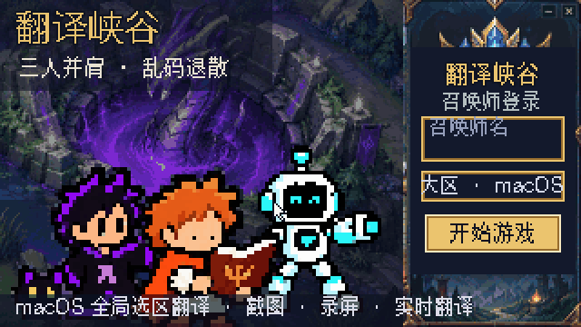

# TranslateApp

<p align="center"></p>

macOS 26+ 全局选区翻译 App，集成截图、录屏与实时翻译。Flutter/Dart 负责界面与翻译业务，Swift 负责系统能力和原生 Liquid Glass 材料。

## 功能

- **选区翻译**：在任意应用选中文字，点「翻译」按钮或按快捷键，展开左译文、右原文的段落对照卡片。
- **截图与标注**：冻结画面框选，支持图形、箭头、文字、画笔、马赛克；可复制、保存或贴图置顶。
- **识别文字 / 翻译文字**：识别截图中的文字供复制，或把译文直接盖在截图原位。
- **录屏与 GIF**：区域、窗口、全屏录制 MP4，结果可导出 GIF。
- **滚动长截图**：框选后手动下滚，自动拼接并去除固定的顶部与底部。
- **实时翻译**：框选区域、窗口或全屏，译文按段落实时覆盖原文；可同时录制。
- **工具栏自由拼接**：在设置里排序、隐藏、绑定快捷键，并拼成父子两级。
- **翻译历史**：成功的翻译自动记录，按来源与日期浏览。

完整说明见 [使用说明](docs/usage.md)。

## 安装与启动

```sh
./scripts/package-and-install-macos.sh
open /Applications/TranslateApp.app
```

首次使用需授予辅助功能（选区翻译）与屏幕录制（截图、录屏、实时翻译）权限。签名、授权与旧副本处理见 [macOS 安装](docs/macos.md)。

| 默认快捷键 | 作用 |
|---|---|
| ⌃⌥T | 翻译当前选区 |
| ⌃⌥S | 区域截图 |

## 翻译服务

在「设置 → 翻译服务」添加并测试，API Key 仅保存在 macOS Keychain。

| 服务 | 必填项 |
|---|---|
| Google 免费接口（非官方，初始默认） | 无 |
| 百度通用翻译 | App ID、密钥 |
| 谷歌翻译（Cloud Translation Basic v2） | API Key |
| OpenAI | API Key、模型 ID |
| DeepSeek | API Key、模型 ID |
| Anthropic | API Key、模型 ID |
| Apple 系统翻译（本机离线） | 无；需在系统设置下载语言包 |

## 开发

```sh
flutter test
flutter analyze
flutter run -d macos
xcodebuild test -workspace macos/Runner.xcworkspace -scheme Runner -destination 'platform=macOS,arch=arm64'
```

构建需要包含 macOS 26 SDK 的 Xcode。架构见 [架构说明](docs/architecture.md)；需求以 GitHub Issue 为准，导航见 [规格索引](docs/specs/README.md)。
