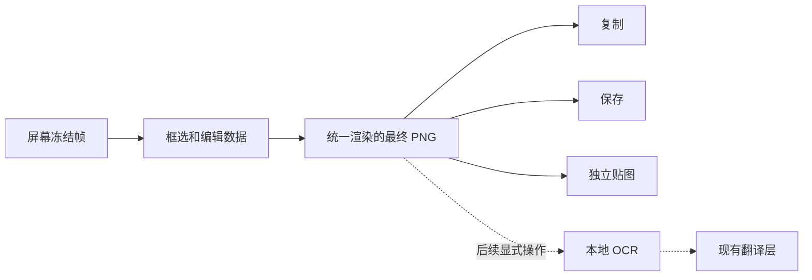

# 截图原地编辑与贴图技术设计

状态：#27/#26/#22 核心路径已实现（无边框编辑层、双击复制、贴图、设置分段见 #37）；捕获使用 ScreenCaptureKit 冻结帧，框选由 Dart 完成（见 `docs/architecture.md`「区域截图」）。跨显示器连续框选未纳入当前范围。

Codex-Thread: 01a06fe3-df48-7fb0-983b-443d579db93e

## 文档性质与执行范围

1. 本文是技术设计文档，记录模块接口、设计模式、状态流转与验收条件；产品行为、数值、规范性技术边界分别见[功能规格](https://github.com/1504101951/translateApp/issues/1)、[样式规格](https://github.com/1504101951/translateApp/issues/67)、[架构设计约束](https://github.com/1504101951/translateApp/issues/68)，执行进度由现有工单跟踪。设计决策直接记录在本文，不另建 ADR。
2. 按 `codebase-design` 的深模块原则设计：接口隐藏捕获、编辑、导出的复杂性；概念上的模块不要求各自新增抽象类或目录。
3. 实施沿用 #25、#26、#27、#22；OCR 接入沿用 #20。

## 目标与交互

1. 截图直接在桌面的冻结画面中框选，选区外变暗、选区内保持清晰。选区可移动、通过八个控制点调整。工具栏依次检查选区下方、上方、右侧、左侧的空白；外侧都不足时允许放在选区内部靠边。工具栏完整位于屏幕内，画布不缩放、不移动，源图及导出尺寸不变。拖动时隐藏工具栏并保持画布坐标系不变，松开后按已提交选区定位。
2. 工具栏在上下方横向排列，在左右侧纵向排列；工具按钮及当前文字工具的颜色、字号控件沿对应方向滚动。复制成功以工具栏上方的独立浮层显示 1 秒，连续成功重新计时，屏幕边缘自动避让；浮层不拦截点击，关闭或替换截图即清除。错误与保存状态保留在工具栏尾部，工具栏和浮层均不进入最终图片。
3. 不创建居中的独立预览窗口。保存直接写入设置中的固定目录，成功只在工具栏附近反馈。目录选择、自动命名说明、截图快捷键归入设置页。
4. 默认目录为 `~/Pictures/截图`，首次实际保存时创建；用户可在设置中改为其他目录。重名追加序号，目录不可用时保留编辑结果并提示错误，不静默切换目录。
5. 双击未被文本输入占用的图片区域，复制编辑后的图片并结束本次截图；文本编辑中的双击保留选字行为。
6. 非文字输入状态下，回车或小键盘回车复制编辑后的图片并结束截图；文字输入时回车换行，点击框外、Esc 或切换工具结束输入。复制失败时保留编辑内容供重试。非文字输入状态下 Esc 关闭本次截图编辑并丢弃未导出的草稿；已保存/复制的结果保持有效。工具栏保存和复制后可继续编辑，双击复制及贴图成功后结束本次截图。
7. 矩形/椭圆指图形标注，截图裁剪选区保持矩形。圆形裁剪不在本轮范围。

## 标注工具及属性

| 工具 | 行为 | 可调属性 |
| --- | --- | --- |
| 图形 | 矩形框、圆形框、矩形填充、圆形填充；圆形按短边约束 | 模式、颜色，描边支持粗细 |
| 箭头 | 拖动确定起终点，箭头尺寸随线宽 | 颜色、粗细 |
| 文本 | 点击放置文字框；单击选中、再次点击编辑；拖动只改宽度，高度随内容；空框自动删除 | 颜色、字号 |
| 画笔 | 连续普通笔划或马赛克笔划 | 模式、粗细；普通模式支持颜色 |

属性显示在工具栏第二行，每种具体图形与画笔模式独立记忆参数；第二行模式按钮各自使用玻璃材料。马赛克不提供颜色入口，填充图形不提供线宽入口；四种图形及画笔模式与参数均持久化。

马赛克通过选中删除或撤销调整。预览与最终图片均按“原图 → 马赛克 → 普通标注”的顺序绘制。

## 模块与接口

| 模块 | 所有内容与职责 | 对外接口及约束 |
| --- | --- | --- |
| 系统截图模块，Swift | 本进程申请屏幕录制、显示器冻结帧、无边框窗口容器、显示器坐标变换、结束时还原窗口状态 | 开始捕获向 TCC 登记 TranslateApp 并返回 captureId、冻结位图及显示器矩形；结束/cancel 释放本次资源。无权限或错误不进入编辑，不改变剪贴板或文件 |
| 截图编辑模块，Dart | 框选状态、标注数据、选中对象、工具属性、未提交笔划/文本、撤销重做 | 接收冻结帧；输入手势更新编辑数据；输出固定版本的最终 PNG。Swift 不处理画笔/文字等编辑规则 |
| 图像导出模块，沿用现有 Dart 流程和 Swift 系统能力 | 自动命名、保存、复制、组合操作和过期操作拒绝 | 只接收 captureId 与已经渲染的 PNG；各出口不能自行回读未编辑原图。复制并保存准确报告部分成功 |
| 贴图模块，Swift 窗口加图像显示 | 独立置顶图像、位置、缩放和关闭；允许多张贴图 | 接收最终 PNG 创建独立贴图；拖动、缩放、关闭只影响目标贴图，之后的编辑不改变已贴出的图片 |
| 设置模块，沿用 AppSettings/设置页 | 固定保存目录、自动命名规则、截图热键 | 目录选择先改表单草稿，与其他设置一起保存。截图编辑器消费已保存配置，不另存第二份目录配置 |

保持现有 Flutter/Dart 承担界面与业务的分工。原生截图窗口提供承载与系统能力，不把整个编辑器搬到 Swift；现有截图 Flutter 入口可以承担编辑层，独立普通预览的布局被移除。

## 采用的设计方式

1. **命令模式（Command）：管理编辑历史。** 一次完成的笔划、形状拖动、文本提交、裁剪调整、已提交标注的改色或删除，形成一个可执行与撤销的编辑命令。命令仅保存受影响对象及必要的前后值，删除操作保留恢复层级所需的位置；原始位图只保留一份。拖动过程更新草稿，完成后才入栈；撤销后提交新命令清空重做栈。切换工具和修改下一笔的默认颜色不进入图片历史。
2. **策略模式（Strategy）：复用实际不同的手势。** 使用自由笔划、拖动图形、文本输入三类处理方式；普通画笔与马赛克共用笔划逻辑，矩形、椭圆和箭头共用拖动逻辑，再由类型与样式数据决定绘制结果。用枚举和小范围分发表达策略，不为每个工具图标建立类，也不引入工具插件框架。
3. **显式状态机：管理输入与会话。** 会话为 `空闲 → 捕获中 → 框选 → 编辑 → 导出`；编辑期间明确区分普通操作、拖绘与文本输入。状态用枚举和明确的迁移规则表示，不采用每状态一个子类的 State 层级。未完成草稿与已提交文档分开，防止双击、Esc、异步导出同时改变同一份数据。
4. **观察者模式（Observer）：刷新界面。** 复用 Flutter 的 `ChangeNotifier/Listenable` 将编辑结果通知画布、工具属性和撤销按钮。命令提交顺序由编辑模块直接管理，通知只负责展示更新，不承担全局事件调度。
5. **统一渲染入口：保证展示与输出一致。** 这是实现约束，不是另一个 GoF 模式。画布预览和 PNG 导出使用同一绘制实现，依次处理裁剪、马赛克及普通标注。导出只包含最终裁剪像素，不包含工具栏、控制点、未裁剪原图或可还原编辑数据。复制、保存、贴图均消费这一渲染结果。
6. **备忘录（Memento）仅辅助命令保存局部前态。** 不为每次编辑复制整张 PNG，也不另建完整文档快照系统。组合模式（Composite）等到确有分组编辑需求再考虑；当前平铺标注列表足够。
7. **不新增 GoF 桥接模式（Bridge）层级。** 当前平台仅 macOS，编辑绘制统一由 Flutter 负责，系统操作沿用 Swift 和现有平台消息桥接。`MacPlatformBridge` 的名字不代表已经采用 GoF Bridge；未来出现真实的多个平台实现时，再根据变化点确定接缝。

## 接口契约与状态约束

1. **捕获接口**：输入为用户显式启动截图的操作；结果为本次 `captureId`、冻结图像、显示器 ID、全局逻辑矩形、像素尺寸及坐标变换。取消返回取消状态；权限或捕获失败返回可展示的错误，均不进入编辑。显示器信息由系统捕获模块提供，编辑模块不自行猜测坐标。
2. **编辑接口**：接收当前捕获结果及已保存设置；手势只更新当前草稿，提交后产生编辑命令与递增的 `documentVersion`。撤销、重做同样递增版本，不能把旧版本号重新用于异步结果。外部调用方读取可导出状态及最终图像，不直接修改历史栈。
3. **导出接口**：明确操作为复制、保存、复制并保存或贴图；输入绑定 `captureId`、`documentVersion` 和一次渲染得到的最终 PNG。结果分别报告剪贴板、文件路径或贴图创建情况；复制并保存发生部分成功时准确展示已完成的动作。PNG 完成前会话已经关闭或被替换，丢弃该结果；已经发生的文件写入或剪贴板写入不能声称被取消。
4. **导出状态**：开始前处理当前草稿；是否提交文字或拒绝导出，必须按已确认手势规则执行。导出期间不接受第二次导出或文档编辑；成功保存后回到编辑，失败保留编辑数据以便重试。复制或贴图后是否退出遵循“目标与交互”第 6 条，Esc 可以结束当前会话。
5. **贴图接口**：接收不可变的最终 PNG，返回可独立关闭的贴图标识。每张贴图独立管理位置与生命周期，之后的编辑、截图会话结束或切换来源应用均不修改它。
6. **翻译接缝**：截图和未来的区域实时捕获负责取得图像，本地 OCR 负责产出文字；再映射为现有翻译请求。文字选择直接进入同一翻译层。不同入口保留自身会话与更新频率，翻译层继续处理语言、Provider 与译文，不承担截图、录屏或窗口控制；本轮不预建录屏入口抽象。

## 坐标、输入与生命周期

1. 每屏保留显示器 ID、全局逻辑点矩形、真实位图尺寸和变换信息。原生负责 AppKit 坐标到窗口局部坐标；Dart 将手势位置转换为源图片像素坐标。标注、裁剪和导出都以图片像素为标准，缩放只改变显示变换，不能直接拿 Flutter 逻辑像素去裁剪 Retina 原图。
2. 不用主屏高度推算其他屏幕坐标。当前支持任意单块显示器内的选区；跨显示器连续框选见“范围与默认行为”。
3. 进入截图前先取得屏幕图像，再显示选择/编辑层，避免工具栏和自身窗口进入抓屏。截图全程暂停文本选区翻译手势；退出时只恢复仍有效的译文会话。
4. 编辑层为了文本输入可以接收键盘焦点；结束后按仍在运行的来源应用还原焦点。它不复用不能成为 key/main 的翻译面板。贴图的点击与拖动避免激活来源之外的应用。
5. Esc 只关闭当前正在操作的编辑层或当前选中的贴图，不连带关闭其他贴图或译文。贴图还应提供明确关闭入口。截图与译文不能同时消费同一关闭动作。
6. 导出开始时固定 captureId 与文档版本；新截图或新编辑不能被旧异步导出结果覆盖。贴图接收不可变的最终图片，独立于截图编辑会话。

## 实施顺序与现有工单

1. **设置和原地编辑基础**：固定目录移入设置；取得屏幕冻结帧及坐标；无边框选区、可移动工具栏、基础复制/保存、双击和 Esc。涉及 #25、#27、#26；保留现有截图热键注册及文件不覆盖逻辑。
2. **标注与历史**：画笔、矩形/椭圆、箭头、文本、颜色/粗细/字号、选中修改、撤销重做，以及共享预览/导出渲染。扩展 #27。
3. **马赛克**：实现图层顺序，验证最终 PNG，不把显示效果当作已经导出的遮挡。仍属 #27。
4. **贴到屏幕**：独立置顶、拖动、缩放、多张并存和定向关闭；只接收最终渲染图片。使用 #22。
5. **截图翻译**：上述图像链路稳定后，本地 OCR 消费用户最终可见的截图，再进入现有 TranslationRequest。仍使用 #20，不将 OCR、录屏或长截图塞进本轮编辑器实现。

#27 可以按这几步分别提交并记录验收，不另建重复的画笔/矩形等零散工单。每一阶段完成代码与自动检查后再交付用户实机验证。

## 验证要求

1. 使用合成图片进行像素级检查：裁剪准确、形状/文字/高亮输出一致、透明边缘无黑底；颜色和线宽变化能在导出中体现。
2. 马赛克区域导出后原始文字不可还原；导出的文件只含最终裁剪位图。
3. 一次拖绘只增加一条历史；撤销/重做、选中改色、文本修改后导出结果准确。撤销后新增操作清空重做历史，删除再撤销恢复对象层级；切换工具不影响文档历史。开始新截图清空旧草稿与历史。测试断言文档和像素结果，不只断言命令方法被调用。
4. 双击在普通图片和文本输入中的作用各自验证；Esc、关闭、保存失败、复制失败和导出期间切换会话不交叉影响。
5. 用户实测普通屏/Retina、副屏、不同缩放率、多张贴图，以及退出编辑后的来源焦点、系统权限和翻译功能。遵守用户约定，由用户操作桌面完成这些验证。

## 当前代码接缝

1. `ScreenshotWindowController.capture(displayID:)` 通过 ScreenCaptureKit 取得显示器冻结帧并创建冻结编辑会话；`show(compact:)` 按冻结选区配置无边框窗口，无权限或失败时显示小窗。
2. `ScreenshotApp._export()` 和 `ScreenshotStorage.save()` 承担组合操作结果与文件不覆盖；导出输入是编辑后的 PNG。
3. 保存目录是 `AppSettings.screenshotSaveDirectory`，随设置事务写入 UserDefaults（`AppConstants.screenshotSaveDirectoryKey`），截图编辑器与采集共用这一个值。

## 范围与默认行为

1. 当前支持在任意单块显示器内框选；跨不同缩放率显示器的连续框选涉及合成分辨率，未纳入当前范围，纳入前需确认验收且不得默默降采样。
2. 双击复制后结束截图，文字输入中双击保留选字；非文字输入状态下 Esc 直接结束当前截图。

## 绘制样式与本设计的职责边界

颜色和线宽采用共享样式值与独立控件的组合设计，规范见[架构设计约束](https://github.com/1504101951/translateApp/issues/68)。本文的手势Strategy、编辑Command和流程状态机不承担每种颜色/线宽的策略分派。复用既有编辑历史；控件返回值，控制器选择目标对象，标注冻结样式，预览与导出读取同一数据。
